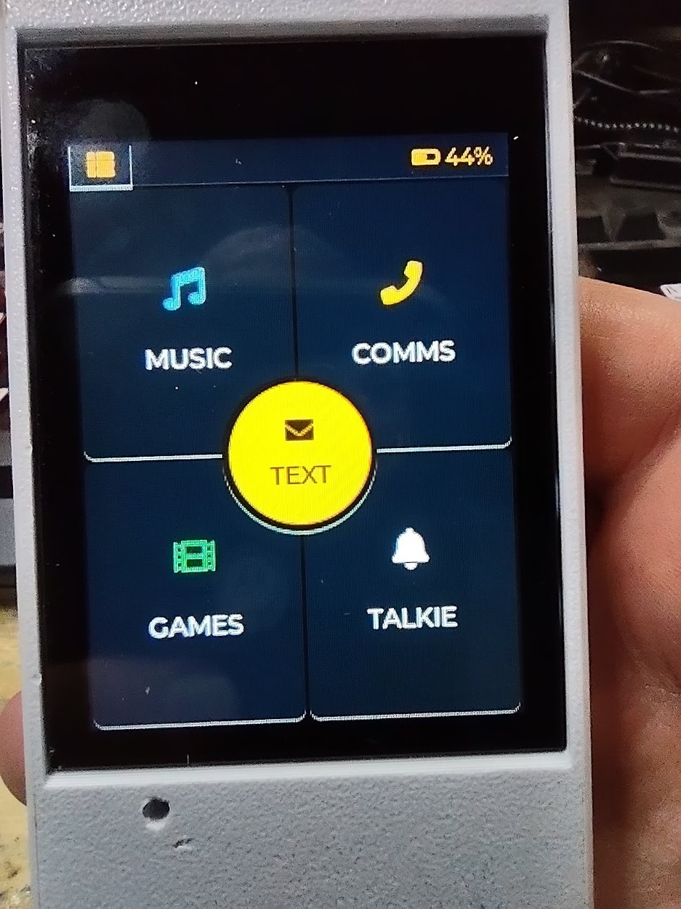
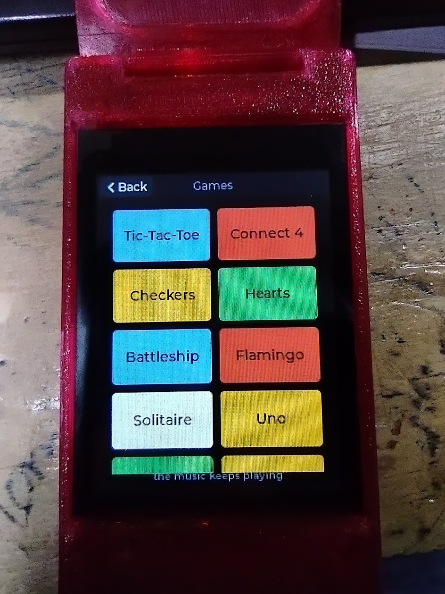
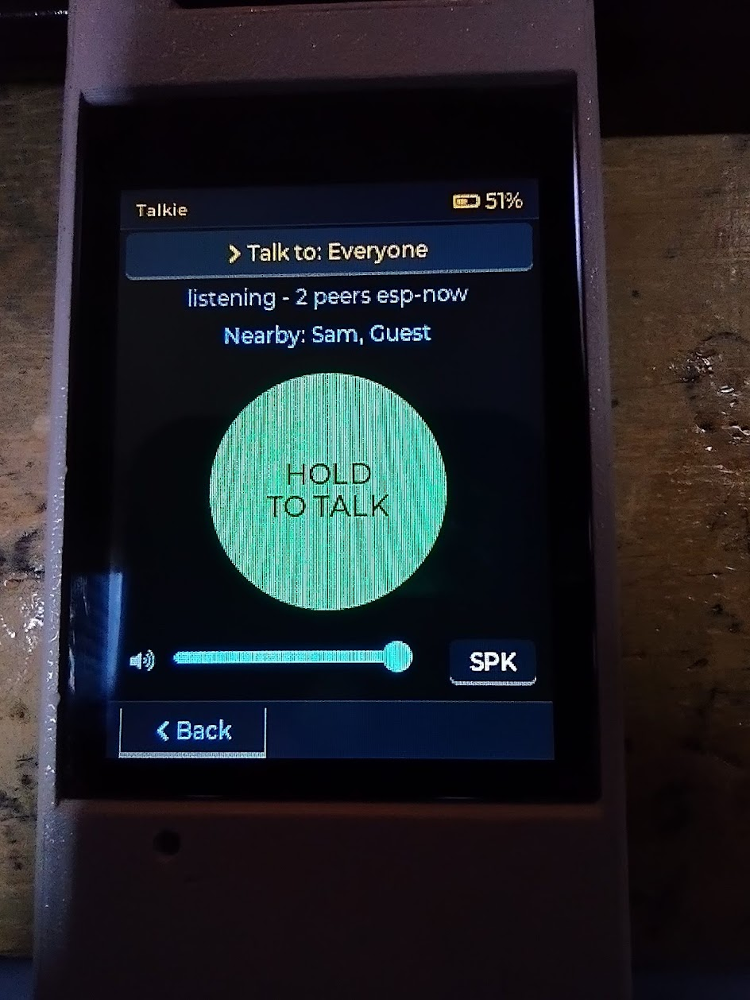

# kids-communicator

A handheld communicator for kids. Two or more of them talk to each other
directly over the air — **no wifi, no internet, no account, no server, and no
subscription.** Turn two on anywhere and they find each other.

## See it working

Two handsets, recorded straight from their own screens: first-time setup,
pairing, music, Connect 4 played between the two, the talkie, and Solitaire.

<table>
  <tr>
    <td width="50%"><video src="https://github.com/user-attachments/assets/b2dabb0a-016c-4b05-8e15-62bc8102ddb3" controls muted width="100%"></video></td>
    <td width="50%"><video src="https://github.com/user-attachments/assets/813134ef-224e-45d3-b05b-8c8cf97b7fe8" controls muted width="100%"></video></td>
  </tr>
</table>

*Comms (asking questions out loud) at the end of the Kid 1 video uses the
optional [home gateway](docs/GATEWAY.md).*

Built by a dad for his four kids, who have been carrying them daily since
August 2026.

  
  
  

## What it does

- **Text messages** between handsets, typed on a T9 keypad with predictive text
  (filtered for children) and a spell mode for names
- **Walkie-talkie**: live voice, push to talk, to one handset or to everyone
- **Games played handset to handset**: tic-tac-toe, Connect 4, checkers,
  Battleship, Hearts, Tanks (artillery, with wind) and Uno for up to four
- **Games for one**: Solitaire, Flamingo (a tap-to-fly side scroller),
  Brick Breaker and Snake. Several of the two-player games, Tanks among them,
  also have a computer opponent
- **Music player**: MP3s from a microSD card, with album art, and the card
  mounts as a USB drive so nobody has to open the case to load music
- **Map** *(experimental)*: an offline vector road map with a GPS position.
  It works, but it is not finished; expect rough edges
- Runs on a battery, in a 3D-printed case, in a pocket

## Why there is no wifi

This is the central design decision, and everything follows from it.

The handsets talk over **ESP-NOW** — Espressif's direct radio protocol. There is
no access point to join, so:

- **the firmware holds no credentials of any kind.** No wifi password, no API
  token, nothing to leak and nothing to type in.
- **it opens no network sockets.** A handset cannot be reached from the internet
  because it is not on the internet.
- **it works anywhere** — a campsite, a car, a school playground. Nothing to set
  up when you get there.

The cost is honest: no internet radio and no over-the-air updates (the clock
comes from GPS, when the handset has one). For a device handed to a child, that
trade is worth it.

### Home Assistant, without putting your password in a child's pocket

If you run [Home Assistant](https://www.home-assistant.io/), an optional
**gateway** adds **Comms**: press, ask a question out loud, read the answer on
screen. The gateway is a cheap ESP32 that stays at home, plugged in. It holds
the WiFi password and the Home Assistant key, so the handsets still hold none.
A handset that leaves the house just stops being able to ask. See
[`docs/GATEWAY.md`](docs/GATEWAY.md); the ESPHome config is in
[`gateway/`](gateway/).

> **Status: buildable.** The firmware in `firmware/` is the same code that runs
> on the family's handsets, minus the WiFi and smart-home parts. Start with
> [`firmware/README.md`](firmware/README.md).

## Hardware

One board does almost everything: an **ESP32-S3 with a 2.8" touchscreen**
(sold as the ES3C28P, and by Hosyond and LCDwiki among others), plus a speaker,
a microphone, a battery and a microSD card.

Full parts list with pictures and where we bought each part:
[`docs/HARDWARE.md`](docs/HARDWARE.md).

## The case

Three printed parts, all original work, in `case/`, plus a newer revision of
the whole case as one combined mesh. See `case/README.md` — and
read the note there before regenerating the STLs from the FreeCAD source.

## Status

| Piece | State |
|---|---|
| Firmware | ✅ Builds on ESP-IDF 5.3; tested on real handsets |
| Radio encryption | ✅ Per-link encryption between paired handsets (see below) |
| Case STLs | ✅ Three printable parts, plus the 2026-10-06 revision as one combined mesh |
| Case FreeCAD source | ✅ Included, vendor board model removed |
| Map | 🧪 Experimental |
| Predictive text | ✅ Filtered for children; names are spelled once and remembered per handset |
| Home Assistant gateway | ✅ ESPHome config in `gateway/`, guide in `docs/GATEWAY.md`. Two running at home |
| Parts list | ✅ Every part with a photo and a link; fasteners still to list |
| Licence | ✅ GPL-3.0, see `LICENSE`, with third-party credits in `NOTICE.md` |

### Radio security: what is protected and what is not

Every handset in a family is set up with the same **fleet code**, typed in once.
Handsets then pair with each other, and each pair gets its own encryption key
derived from that code. The code never leaves the handset.

**Encrypted, between paired handsets:** text messages, game moves, and
walkie-talkie voice, whether to one handset or to everyone.

A message that claims to come from a family handset is accepted only if it
arrives encrypted from a handset that is already paired. A stranger's ESP32
cannot inject a text that looks like it came from a sibling. That was tested by
building exactly that attack and confirming the handsets now drop it.

**Not encrypted:**

- **The presence beacon.** Each handset announces itself about once a second so
  the others know who is in range, and that announcement carries the handset's
  **display name** in the clear. Anyone nearby with an ESP32 can see it. Pick
  names with that in mind.
- **Walkie-talkie "to everyone" with more than four other handsets.** Past four
  listeners the handset switches to a single broadcast, and ESP-NOW cannot
  encrypt broadcasts.

## Credits

Built on [ESP-IDF](https://github.com/espressif/esp-idf),
[LVGL](https://lvgl.io/) and [minimp3](https://github.com/lieff/minimp3).
Full attribution, with each project's licence, is in [`NOTICE.md`](NOTICE.md).
