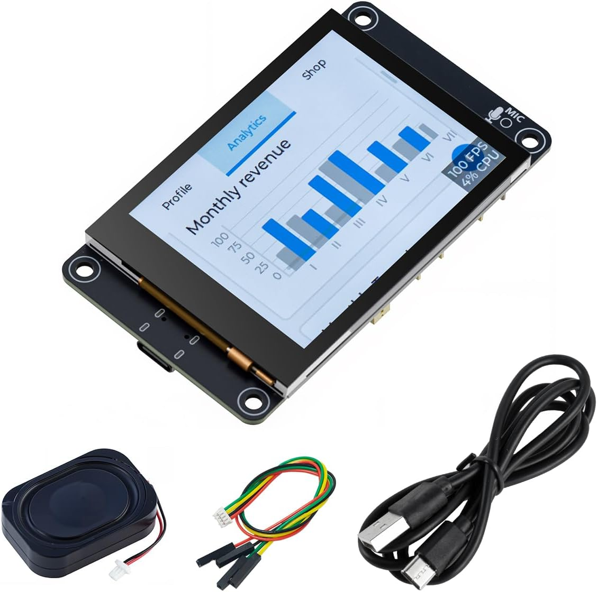
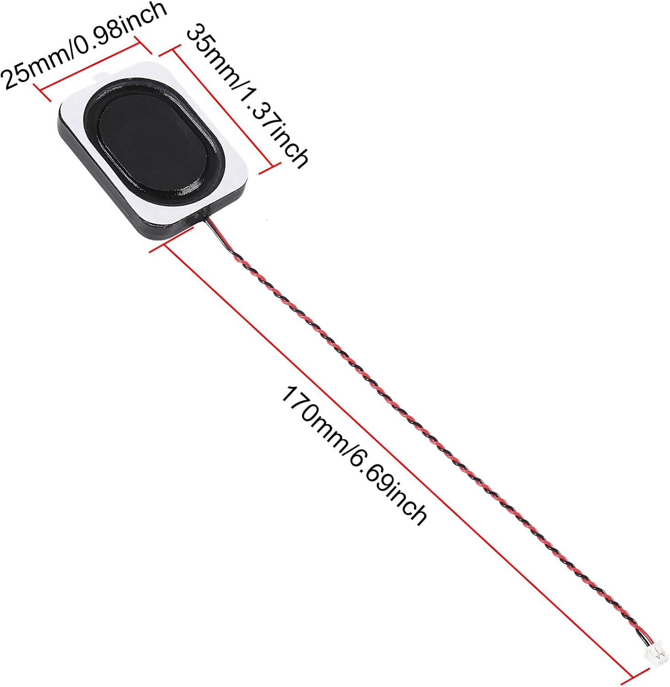
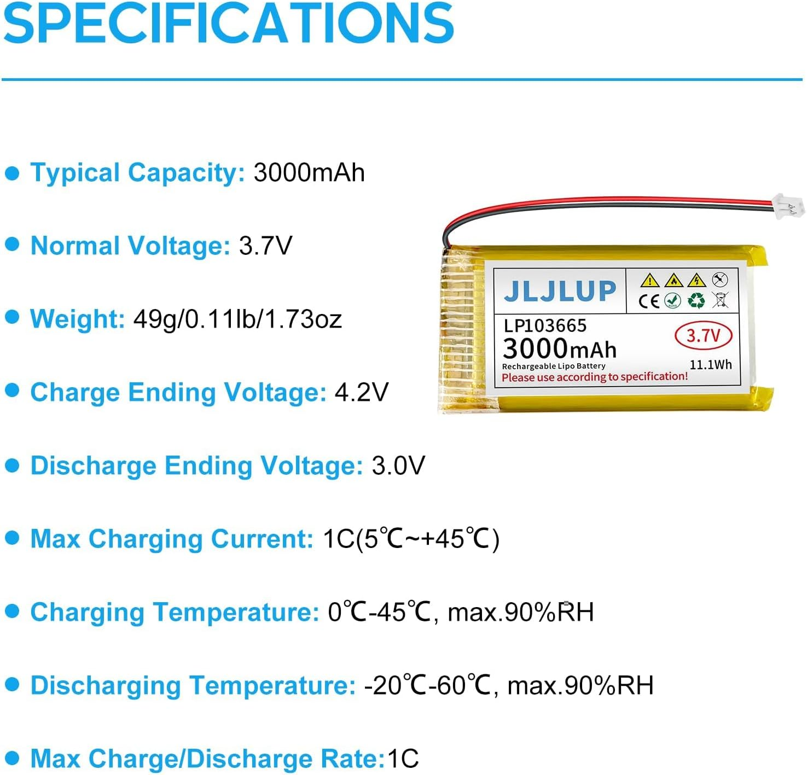
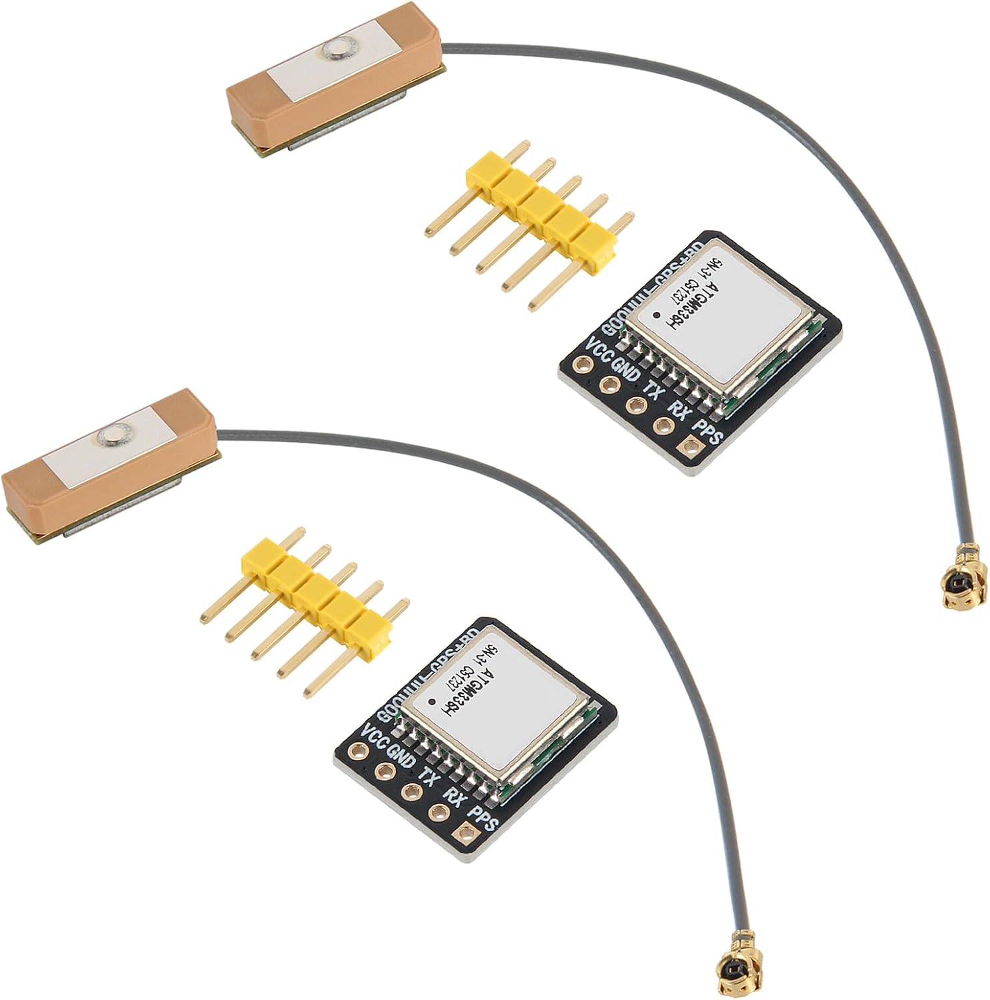
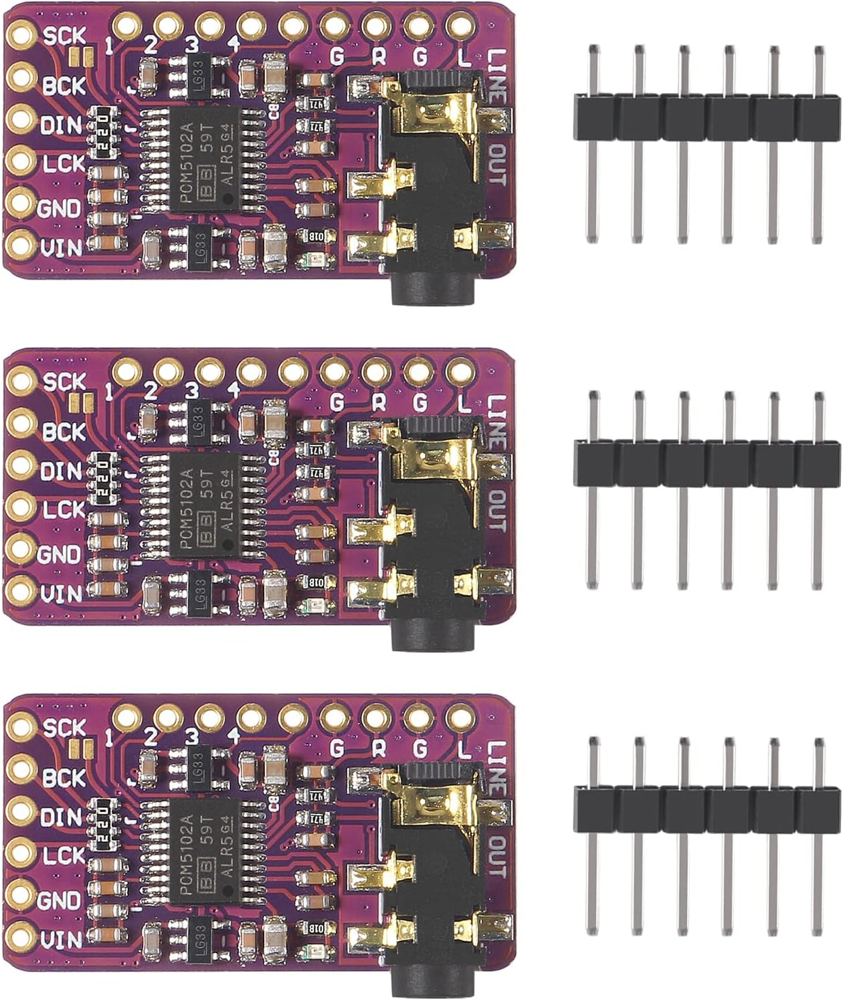
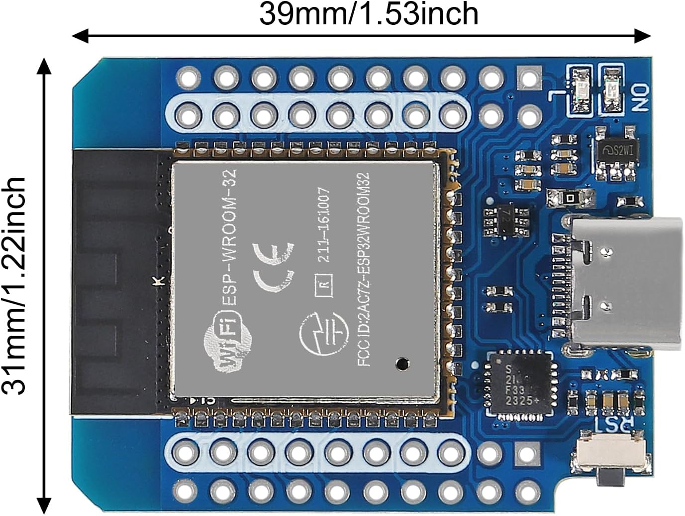

# Parts list

These are the exact parts the family's handsets are built from, with the
listings they were bought from (October 2026). Listings change and disappear;
the "What matters" column is what to match if a link has gone.

## The one part that matters

An **ESP32-S3 development board with a built-in 2.8" touchscreen**, sold under
several names — ES3C28P, and by Hosyond and LCDwiki among others. It carries the
processor, the display, the capacitive touch panel, the audio codec, the
amplifier and the microSD slot on one board.

Notes that will save you money:

- ⚠️ **PSRAM is not optional** for this firmware, and listings are not reliable
  about whether a board has it. Buy from a seller who states it plainly.
- ⚠️ **The ESP32-S3 has no Bluetooth Classic**, only BLE. If you find a guide
  claiming an S3 can pair with ordinary Bluetooth headphones, it is wrong.

## Everything else

| | Part | What we used | What matters |
|---|---|---|---|
|  | Main board | [Hosyond ESP32-S3 2.8" 240×320 IPS capacitive touchscreen module](https://www.amazon.com/dp/B0FKG7WRWV) | The board above. Microphone, codec, amplifier and microSD slot are on the board |
|  | Speaker | [ACEIRMC 4 Ω 3 W cavity speaker](https://www.amazon.com/dp/B0FM3QN15Q) (10-pack) | 25 × 35 mm, JST 1.25 mm 2-pin plug, 170 mm lead |
|  | Battery | [JLJLUP 3.7 V 3000 mAh LiPo, LP103665](https://www.amazon.com/dp/B0FR8XSXX6) (4-pack) | About 10 × 36 × 65 mm, JST 1.25 mm plug. ⚠️ **Must have the protection circuit at the tab**, which this one does. Check the plug's polarity against the board before connecting: LiPo plugs are not standardised |
| | microSD card | Any reasonable size | Music and map tiles |
|  | GPS *(optional)* | [ATGM336H GPS + BDS module](https://www.amazon.com/dp/B0GVYQ8ZV2) with its ceramic patch antenna | UART. Only needed for the map and the clock. The antenna is separate, on a small IPEX/U.FL lead |
|  | Headphone board *(optional)* | [ACEIRMC PCM5102A I2S DAC module](https://www.amazon.com/dp/B08YNJGSN4) (3-pack), 3.5 mm jack | For wired headphones. The built-in speaker keeps working; headphones are for music |
| | Screws | [uxcell M3 × 6 mm flat-head hex socket screws, 304 stainless](https://www.amazon.com/dp/B07WCT7SX7) (80-pack) | **4 per handset**, to mount the board. They thread straight into the printed ASA, with no inserts. These are what was on hand and they work; any M3 × 6 flat-head should do. Heat-set brass inserts would hold better: see the note in [`case/README.md`](../case/README.md) |

## The Home Assistant gateway *(optional)*

Only needed for Comms. See [`GATEWAY.md`](GATEWAY.md).

| | Part | Notes |
|---|---|---|
|  | ESP32 board | We used an [AITRIP Type-C D1 Mini ESP32](https://www.amazon.com/dp/B0CYC227YG) (ESP-WROOM-32, CP2104 USB chip, 39 × 31 mm, 3-pack). Any **original** ESP32 with 4 MB flash works: an "ESP32 DevKit" / ESP32-WROOM-32 board. Not an S3, C3 or C6. No PSRAM needed |
| | USB cable + charger | It stays plugged in at home |
| | *(alternative, untested)* Ethernet ESP32 | WT32-ETH01 or Olimex ESP32-POE: frees the radio from the WiFi router's channel |

## Printed parts

Three, in `../case/stl/`. See `../case/README.md`.

The family's cases are printed in [iSANMATE ASA, 1.75 mm](https://www.amazon.com/dp/B0DB176JW6)
(purple). ASA stands up to sun and heat better than PLA, which matters for
something left in a car or a pocket.

---

*Part photos are the sellers' own listing images, shown so you can recognise
each part. They belong to those sellers and are not covered by this
repository's licence; see [`NOTICE.md`](../NOTICE.md).*
